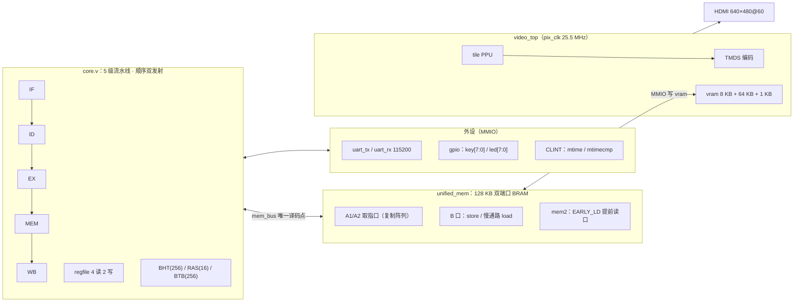

# 基于紫光同创 FPGA 的 RISC-V 顺序双发射 SoC

> 全国大学生嵌入式芯片与系统设计竞赛 —— FPGA 赛道 · 紫光同创选题
> 一句话：**一颗自研 RV32IMA 双发射 CPU + 128 KB 统一存储器 + HDMI 五子棋 + RT-Thread，一颗位流三条启动路径。**

器件：紫光同创 **Logos2 PG2L200H-6FBB676**　工具：**Pango Design Suite 2022.2-SP6.4**
处理器：**RV32IMA**（+ Zicsr/Zifencei），5 级流水线（IF/ID/EX/MEM/WB），**顺序双发射**

## 这个项目是什么

不是"跑通一条指令"的课程作业，也不是"只跑分"的 Demo，而是一台**上电即可交互**的小计算机：

- **处理器全自研**：五级流水线、顺序双发射（lane B 可发 ALU 与 load）、BTB/RAS 分支预测、
  精确异常与中断、多拍除法器、两拍乘法器；可选 4 KB/侧两路组相联 I/D Cache。
- **SoC 完整**：128 KB 统一存储器（一块双端口 BRAM 同时做取指与数据）、单点地址译码的 `mem_bus`、
  UART 115200、8 位 GPIO、CLINT 定时器，以及**独立时钟域**的 tile PPU + TMDS 视频子系统。
- **软件成体系**：移植 RT-Thread（BSP + 中断栈切换 + 静态线程），跑五子棋人机对弈（渲染高优先线程 +
  AI 低优先线程），另有 CoreMark 1.0 移植与 RT-Thread CoreMark 终端监控屏。
- **一颗位流三条路径**：复位时读按键，同一份 `mem.hex` 里 boot + CoreMark + RT-Thread 三块镜像共存，
  默认进五子棋、按住 SW6 跑分、SW6+SW7 进终端监控屏——**不用重新下载位流就能换演示内容**。

## 当前成绩（2026-10-19，交付 + T7 演示线）

| 项目 | 结果 |
|---|---|
| CPU 架构 | **RV32IMA**（+ Zicsr/Zifencei），5 级流水线，**顺序双发射** |
| 生产主频 | **76.5052 MHz**（`STATIC_RATIO0=15.0`，`UART_DIV=664`） |
| 时序 / Fmax | CPU 域 **WNS +0.304 ns / 0 失败端点（21,135）**，Estimated **Fmax 78.3269 MHz**，`All Constraints Met` |
| CoreMark 跑分 | **352.5**（ITER=3900，`Total ticks 846,440,591` = 11.0638 s） |
| 执行效率 | **4.6075 CoreMark/MHz**（每迭代 217,036 拍，仿真 217,088） |
| 资源 | **LUT 7,740 / 159,800（4.84%）**，FF 3,692，DRM 165.5 |
| 操作系统 | **RT-Thread 已移植**：render/AI 双线程 + CoreMark 终端监控屏（`UI TICK` / `UPTIME` / `HEAP FREE` 均为 `rt_tick_get()` / `rt_memory_info()` 实时值） |
| 外设 | **UART、HDMI（PPU + TMDS）、按键** |
| **官方交付位流** | **`b45941d6`**（rev1028，76.5052 MHz，352.5 / 4.6075 / +0.304 / 78.3269 / LUT 7,740） |
| **T7 演示位流** | **`6E2D6020…`**（2026-10-19 17:01，combined：boot + CoreMark + RT；CoreMark 与交付**逐位同分**，RT-Thread 堆 1,440 B） |

> [!] **两套数据的边界**：官方交付 `b45941d6` 是 2026-10-17 的 rev1028 单一位流；T7 `6E2D6020…`
> 是 2026-10-19 的 combined 演示位流（同一颗 RTL / 同一时钟，只是加了 CoreMark 终端监控屏）。
> **CoreMark 计时与四个 CRC 两者逐位相同**，不是两次不同成绩。
> **85.0051 MHz / 391.66 分 / 4.6064** 是更早的 rev1027 历史线（`c6af65be`），**不是当前交付**。
>
> 唯一数字源：`doc/reports/2026-10-17_delivery_rev1028.md`（交付）、
> `doc/reports/2026-10-19_t7_coremark_demo_handoff.md`（T7）。技术文档见 `doc/contest/技术文档_v1.docx`。

### 历史线（只作演进对照，不是交付）

| 位流 | 主频 | 经典分 | 主分 | 关键变化 |
|---|---|---|---|---|
| `c6af65be` | 85.0051 MHz | 391.66 | 4.6064 | rev1027，85 MHz 收敛极限（8 seed 证伪后回退） |
| `bcd8fdd2` | 85.0051 MHz | 365.93 | 4.304 | A1 两拍乘法器，每迭代 232,345 拍 |
| `da8ffd31` | 76.5052 MHz | 325.96 | 4.2606 | I+D Cache 全开，仅作评估（负收益） |
| `2ddaf32f` | 85.0051 MHz | 351.86 | 4.139 | 双发射 + EARLY_LD（A1 之前） |
| `ae4deea9` | 85.0051 MHz | 233.85 | 2.751 | 单发射 |
| `main` 历史线 | 62.0309 MHz | 170.64 | 2.751 | 两拍乘法器 + 提频 |

逐条板上证据（串口原始日志、ILA 波形、逐 seed 时序）见 `doc/board/uart_*.txt`、
`pds/RV32I_1/bitstreams/README.md`、`doc/reports/`。

## 1. 系统总览



**一条 load 指令走过的路**（说明模块如何配合）：IF 在 A1/A2 两槽成对取指 → ID 按 `pair_now` 白名单判断
能否同拍发射，不能则 B 槽留到下一拍 → EX 算地址，`EARLY_LD` 有效时把地址提前送进 `ld_addr` →
MEM 从 `mem2`/B 口读数据并把结果前递 → WB 写回。整条路径上**地址译码只发生在 `mem_bus` 一处**，
所以映射错误不会在 core 与顶层各写一份。

### 1.1 模块职责

| 文件 | 模块 | 职责 |
|---|---|---|
| `rtl/core/core.v` | core | 五级流水线数据通路：成对取指、配对、前递、冲刷、访存口 |
| `rtl/core/control.v` | control | 主译码：opcode / funct3 / funct7 → 控制信号 |
| `rtl/core/alu.v` / `multiplier.v` / `divider.v` | alu / mul / div | 算术逻辑（M 扩展乘法映射 DSP，拆 2 拍）/ 多拍迭代除法 |
| `rtl/core/regfile.v` | regfile | 32×32 寄存器堆，**4 读 2 写**（A/B 各一写口，同 rd 时 B 胜） |
| `rtl/core/csr_file.v` | csr_file | CSR + 精确异常/中断；`mimpid` 承载 `DESIGN_REV` |
| `rtl/core/amo_unit.v` | amo_unit | A 扩展原子指令（默认 `A_EXT=0` 不例化） |
| `rtl/mem/unified_mem.v` | unified_mem | 128 KB 统一存储器：取指复制阵列 + 访存口 + 提前读口 |
| `rtl/bus/mem_bus.v` / `addr_map.vh` | mem_bus | 唯一地址译码处 + 读数据 mux；地址映射单点定义 |
| `rtl/periph/*.v` | uart_tx / uart_rx / gpio | 串口（1024 / 16 深 FIFO）、按键与 LED |
| `rtl/video/*.v` | video_top / ppu / rgb2tmds | tile PPU + 行场同步 + TMDS 编码 |
| `rtl/top/cpu_top.v` | cpu_top | SoC 顶层（仿真用），只做连线，参数开关都在这里 |
| `rtl/top/cpu_top_board.v` | cpu_top_board | 上板顶层（PDS 的 top）：PLL 27 → 76.5052 MHz + 引脚约束 + HDMI |

### 1.2 一颗位流三条路径

| 路径 | 触发条件 | 入口 | 镜像占用 |
|---|---|---|---|
| A　RT-Thread 五子棋 | 复位时**松开** SW6（默认） | `0x1_0000` | 12,741 字 |
| B　裸机 CoreMark | 复位时**按住** SW6 | `0x0_1000` | 11,364 字 |
| C　CoreMark 终端监控屏 | SW6 + SW7 **同时按住** | `0x1_0000` + boot flag | 复用 RT 镜像 |

合计 `boot 30 字 + CoreMark 11,364 字 + RT 12,741 字 = 24,135 字 / 48,270 行`（T7 位流）。
`boot` 段只有 30 字，做的事就一件：读 GPIO 的 `key[2]`/`key[3]`（SW6/SW7，低有效），跳到对应入口。

## 2. CPU 设计

### 2.1 指令集与参数

RV32IMA（I/M/A 全部实现）+ **Zicsr / Zifencei**。`FENCE.I` 按 NOP 实现——因为统一存储器天然满足
自修改代码（store 写进去的指令，后续取指直接读到）。所有开关都是 `core.v` 的 `parameter`：

| 参数 | 交付值 | 含义 |
|---|---|---|
| `DUAL_ISSUE` | **1** | 1 = 有限度 2-wide in-order 双发射；0 = 位不变的单发射回退版 |
| `EARLY_LD` | **1** | load 地址提前到 EX 发起，用专用提前读口消掉紧跟其后的 load-use 停顿 |
| `LANEB_MEM` | **1** | lane B 可发 load（不含 store）；lane B 的 load 一律走慢通路 |
| `BTB_EN` | **1** | BTB 只预测 `jalr` 的目标；条件分支目标由 `p_target` 现算 |
| `A_EXT` | **0** | A 扩展默认关（`amo_unit` 不例化，省面积；对分数零影响） |
| `DCACHE_EN` / `ICACHE_EN` | **0 / 0** | 可选 I/D Cache，交付位流不打开 |
| `DESIGN_REV` | `0x2026_1028` | 写进 `mimpid`，上板可用 `csrr` 核对烧的是哪版 RTL |

### 2.2 五级流水线与取指时序

`IF → ID → EX → MEM → WB`。统一存储器 A 口是**同步读、恰好 1 拍延迟**，加上 IF/ID 一级，流水线内部落后 2 拍。
稳态下有三条不变量：

```
imem_rd   = mem[pc_r - 4]      // 在途，下一拍进 IF/ID
if_id_pc  = pc_r - 8           // 正在 ID 译码
id_ex_pc  = pc_r - 12          // 正在 EX 执行
```

`stall` / `div_stall` 时 **`pc_r` 不动，退的是 `imem_addr`**（重读上一拍那个 word）。若把 `pc_r` 也后退，
连续两拍 stall 会让同一条指令被取两次——非幂等指令会被重复执行，历史上踩过。

跳转目标在**冲刷当拍就旁路给取指端**：`imem_addr` 的 mux 在 `ex_flush` 时直接选 `ex_target`，
同时 `pc_r <= ex_target + 4` 跳过它，避免目标指令被取两次。分支惩罚：**预测命中 1 拍，未命中 2 拍**。

### 2.3 双发射：配对规则

成对取指（A1/A2 两个读口同拍取相邻两条），ID 级用 `pair_now` 白名单决定能不能同拍发射：

- lane A 放"较老"的指令，lane B 放"较年轻"的；**一对里最多一条访存**（`pair_now` 排掉 `p_mem_a`），
  lane B 是 load 时 lane A 只可能是 ALU / 分支 / 跳转 / CSR / SYSTEM。
- lane B 能力：ALU 全功能 + load（`LANEB_MEM=1`）；**不放 store**，也不走 `EARLY_LD` 快通路
  （快通路对 lane B 收益为 0，却全压在最贵的时序链上）。
- 寄存器堆 4 读 2 写，A/B 各一套写口；同拍写同一 `rd` 时**B 赢**（程序序更年轻者生效）。
- `ex_flush` 那拍**必须压掉 lane B 的 `reg_write` 与 `valid`**：lane B 是更年轻、更可能站在错误路径上的那条，
  不压制就会漏写一次寄存器——静默错算。
- lane B 的未对齐 load 在 EX 级陷入异常（`mepc` 取 `id_ex_b_pc`），lane A 被杀死后随 `mret` 重放；
  这条路径安全的前提是"被重放的指令都幂等"（ALU 重算同值、CSR 写被 `!trap` 抑制、`mret` 被
  `mret_commit` 抑制），论证写在 `core.v` 的注释里。

### 2.4 冒险处理

| 类型 | 处理 |
|---|---|
| RAW（EX 级） | 两级前递：EX/MEM 优先于 MEM/WB；load 结果不从前递取 |
| load-use | `stall` 停顿 1 拍；走 `EARLY_LD` 快通路的 load 不停顿 |
| 多拍除法 | `div_stall` 停住 EX 及之前各级，`ex_mem` 插气泡 |
| 乘法 | 拆成 2 拍完成（换时序余量，代价约 +2.6% 拍数） |
| 分支/跳转 | ID 级预测命中则当拍重定向（1 拍）；未命中 / `jalr` 走 EX 冲刷（2 拍） |

### 2.5 分支预测

- **BHT**：256 项、2 位饱和计数器、**带 tag**，只预测条件分支方向（`jal` 用静态后向预测，`jalr` 不预测）。
- **RAS**：16 项返回地址栈，专治函数返回——实测 BTB 对条件分支收益有限，RAS 才是正解
  （结论见 `doc/reports/2026-10-13_handoff_btbras.md`）。
- **BTB**：256 项，只预测 `jalr` 的目标；`BTB_EN` 单独开关，因为它要给取指路径加一条 PC 索引的表读。

### 2.6 异常与中断

`csr_file.v` 提供 mstatus / mie / mip / mtvec / mepc / mcause / mtval / mimpid 等；**`mtvec` 只支持 direct 模式**
（写入时强制 `{addr[31:2], 2'b00}`）。定时器中断走 CLINT：MMIO 写 `mtimecmp`，`mtime >= mtimecmp` 置 MTIP，
`mie.MTIE` + `mstatus.MIE` 打开后进 trap。RT-Thread 的 1 ms 节拍就来自这里（`irq_id = mcause & 0x1F`，MTIP → 7）。

### 2.7 可选 I/D Cache（默认关）

- 规格：**4 KB/侧、2 路组相联**，`DCACHE_EN` / `ICACHE_EN` 两个参数，默认全关。
- 交付位流 `b45941d6` 与 T7 `6E2D6020…` 都是 **0/0**，网表里 cache 实例为 0 ⇒ **功能上无 Cache**。
- 有独立证据：只开 D-Cache 的 `FF322E3D…` 在 76.5052 MHz 下 `All Constraints Met`
  （WNS +0.071 ns / Fmax 76.9231 MHz，网表 `g_dcache` 560 处引用、`g_icache` 0 处）。
- **I+D 同开在 76.5052 MHz 时序不过**（−0.750 ns / Fmax 72.3537 MHz）⇒ 不作为交付配置；
  历史 I+D @76.5 的 325.96 分只作对照。

### 2.8 性能演进（每迭代拍数）

```
单发射                        363,515
双发射                        313,886
+ EARLY_LD                    241,633
+ 两拍乘法器（A1）            232,345
+ lane B 放 load（交付档）     217,036（板上）/ 217,088（仿真）
```

交付档主分 **4.6075 CoreMark/MHz** 与主频无关（`Score = Iterations ÷ Total_Time ÷ Frequency`），
所以提频只影响"跑满 10 秒"所需的 ITER，不影响主分——这也是我们把 `A_EXT` 关掉、把 Cache 关掉的依据。

## 3. 存储与总线

- **modified-Harvard**：体系结构上指令与数据共用一个地址空间（gcc 只能产出一份扁平布局），
  核内部取指与访存通路分离，物理上合并成**一块 128 KB 双端口 BRAM**。
  好处：自修改代码可用（`fence_i` 能过）、BRAM 用量减半（利于 CoreMark/LUTs）。
- 端口分配：**A1/A2 取指（A2 是复制阵列，双发射第二读口）**、**B 口访存（store / 慢通路 load）**、
  **mem2 提前读口（`EARLY_LD` 专用，避免与 B 口争用）**。
- 时序契约：同步读、恰好 1 拍延迟、**不做任何仲裁**——`core.v` 的 stall/flush 补偿依赖 A 口每拍都能独立工作。
- `mem_bus.v` 是**唯一**的地址译码点，地址定义集中在 `rtl/bus/addr_map.vh`，软件侧镜像为
  `scripts/demo/addr_map.h`，两处必须同步改。

| 地址区间 | 用途 | 访问方式 |
|---|---|---|
| `0x0000_0000 ~ 0x0001_FFEF` | RAM（128 KB 统一存储器） | 字寻址 `addr[16:2]` |
| `0x0000_FFF0 ~ 0x0000_FFFF` | 兼容寄存器区：`cycle_cnt` / `done` / `UART TX` | `0xFFF4` R / `0xFFF8` W / `0xFFFC` W |
| `0x0000_FF00 ~ 0x0000_FF0F` | CoreMark 成绩邮箱（T7 起） | 裸机档写，RT 档读 |
| `0x8000_0000 + 0x00` | GPIO：LED 与按键 | W `led[7:0]`；R `{key[7:0], led[7:0]}` |
| `0x8000_0000 + 0x08 / 0x0C` | UART TX / RX | 写即发；读弹出 RX FIFO |
| `0x8000_0000 + 0x10 / 0x14` | MTIME / MTIMECMP | `mtime >= mtimecmp` 置 MTIP |
| `0x8001_0000 / 0x8002_0000 / 0x8003_0000` | vram：name table / pattern / palette | CPU 侧只写 |

栈：CoreMark `0xF000`（旧 64 KB 段内），RT-Thread `0x1FFF0`（`scripts/rtthread/bsp/link.ld`）。

## 4. 视频子系统

`rtl/video/` 是一条**独立于 CPU 的通路**，CPU 只通过 MMIO 往 vram 写：

- **tile PPU**：40×30 字符网格、16×16 图块、256 色 × 24 位调色板；显存分三段
  （name table 8 KB、pattern 64 KB、palette 1 KB），另有滚动/隔行参数寄存器。
- **时序**：640×480@60，`pix_clk = 25.5 MHz`，5× 串行 → TMDS 127.5 MHz；`rgb2tmds.v` + `outputserdes.v`
  负责 8b/10b 编码与串并转换。
- **跨域**：`clk_sys`（76.5052 MHz）与 `pix_clk` 同一 PLL 两路输出，CPU↔vram 走异步 FIFO；
  PDS 对该跨域路径单独约束，实测 WNS +6.484 ns、0/21 失败端点。
- **好处**：渲染不占取指带宽，CPU 停顿（长除法、AI 搜索）不会撕裂画面——这也是"AI 思考 5.7 s 期间
  界面与按键正常"的硬件前提。

## 5. 软件栈

### 5.1 分层与目录

```
应用层      game.c（状态机） / ai.c（α-β） / coremark_screen.c（终端屏）
渲染与输入  render.c / input.c / video_port.c（vram 写口封装）
OS 适配层   scripts/rtthread/bsp/：board.c / startup.S / trap_gcc.S / libc_shim.c
硬件抽象层  hw_port.c（MMIO 读写、hw_mtime） / cm_mailbox.h（成绩邮箱）
```

五子棋应用与规则层**刻意不依赖 RT-Thread**：`scripts/gomoku/` 的 board / ai / render / game
在 x86 上可直接编译单测（不需要板子、不需要 RISC-V 工具链、不需要 iverilog），
同一份源码再编进 RISC-V 固件——"一份源码两处用"是硬要求。

### 5.2 RT-Thread 移植要点

走的是官方 `libcpu/risc-v` 指南的**方式一（非向量中断）**，因为我们的 `mtvec` 只有 direct 模式：

```
mtvec = SW_handler
  → SW_handler（interrupt_gcc.S）：关 MIE → 存线程上下文 → csrrw sp,mscratch,sp 切中断栈
  → rt_interrupt_enter → rt_hw_do_after_save_above（trap_gcc.S）
  → rt_rv32_system_irq_handler(mcause)（按 mcause & 0x1F 分发）
  → rt_interrupt_leave → 按需切线程 → mret
```

- `mscratch` 存**中断栈指针**（链接脚本里的 `__rt_rvstack`）。
- `-march` 必须带 **`_zicsr`**：现代规范把 CSR 指令从基础 I 拆出去了，只写 `rv32im` 汇编器会直接报错。
- `src/klibc` 必须单独列进源码目录，且 `vsnprintf` 选 **tiny 版**（小内存下唯一合理的选择）。
- 线程全部**静态创建**（不依赖动态分配线程控制块），堆 **1,440 B**（`[boot] heap = 1440 bytes`）。

### 5.3 五子棋应用

- **规则**：15×15 交叉点，五连即胜，**长连（≥6 子）同样算胜，不实现禁手**（三三/四四/长连禁手判定复杂且
  容易与"算不算胜"纠缠）；胜负已分后落子返回 `GOMOKU_ERR_OVER`，重开走 `gomoku_reset`。
- **状态机**：`GAME_TITLE` / `GAME_PLAYING` / `GAME_OVER` / `GAME_COREMARK` 四态，标题屏内再分
  主菜单 / 人机 / AI 对弈三页，选择项页内回绕。
- **AI**：α-β 剪枝 + 启发式排序，难度对应搜索深度（界面显示 `DEPTH 6 PLY`）；实测单步 0.3~1.9 s。
  `game_tick()` 只"派单"（`game_ai_begin` 拷盘 + 置 `ai_pending`），真正的搜索由宿主决定：
  裸机同步算完，RT-Thread 丢给低优先 AI 线程——**渲染线程不会被搜索阻塞**。
- **渲染**：40×30 name table 写入。8×8 文本图块用于终端正文与监控数值，16×16 图块用于棋盘、装饰与比分大字；
  棋盘外框、坐标轴 A~O / 1~15 与 **23 个装饰图块在运行时合成**，不占 ROM 常量表
  （一次改动把 `.rodata` 减了 9,216 B）。
- **输入**：GPIO `key[7:0]` 帧同步采样，区分短按/长按——长按不会被识别成多次短按。

### 5.4 CoreMark 移植与终端监控屏

- 移植层硬编码三个地址：`0xFFF4` 读周期计数、`0xFFF8` 写 `done`、`0xFFFC` 写串口字符；
  `ITER=3900` 由 76.5052 MHz 下"跑满 10 秒"反推。
- 裸机档跑完把 `SCORE / TICKS / FLAGS(CRC)` 写进 `0xFF00` 邮箱并置 MAGIC。
- RT 档的终端屏（`coremark_screen.c`）读该邮箱**重放**成绩，同时实时显示
  `UI TICK`（`rt_tick_get()`）、`UPTIME`（tick ÷ `RT_TICK_PER_SECOND`）、`HEAP FREE`（`rt_memory_info()`）。
  **它不是"RT-Thread 又跑了一遍 CoreMark"**，而是"同一份真实成绩的忠实呈现"。
- 屏显 `COREMARK SCORE` 为两位小数截断（352.49 / 4.6074），正文与报告统一按 **352.5 / 4.6075** 计。

### 5.5 三条启动路径怎么实现

1. 链接脚本把 boot 放在 `0x00000`、CoreMark 放在 `0x0_1000`、RT-Thread 放在 `0x1_0000`，
   `scripts/merge_images.py` 校验重叠后合并成一份 `mem.hex`。
2. 复位后 boot 读 `key[2]`/`key[3]`：松开 → `0x1_0000`（RT），按住 SW6 → `0x0_1000`（CoreMark），
   SW6+SW7 → `0x1_0000` 并置 boot flag（终端屏）。
3. RT 档启动时检查该 flag 与邮箱 MAGIC，决定进五子棋标题屏还是直接进终端屏。

## 6. 验证与证据

### 6.1 指令级回归

riscv-tests 全量：**49 PASS / 1 FAIL / 0 TIMEOUT**（`doc/test_report_riscv-tests.md`）。

唯一 FAIL 是 `ma_data`（未对齐访存）。2026-09-21 曾据一次测量认为"取指重定向后它自动转为 PASS、
说明是冲刷路径的潜在 bug"，**该结论已复核并撤回**：用改造【之前】的 RTL 复测同样是 FAIL，
前后行为完全一致（2026-09-25 再次复核，迁移前后都是 `testnum 668`）。
真实归因是未对齐访存不做特殊处理（**RISC-V 规范允许**，属架构取舍）。
未对齐通路没有专门的测试覆盖，**不把它当作已实现的功能对外承诺**。

### 6.2 CoreMark 一致性

四个 CRC 与仿真逐位相同：`seedcrc 0xe9f5` / `crclist 0xe714` / `crcmatrix 0x1fd7` / `crcstate 0x8e3a`，
板上 `Correct operation validated`。拍数：板上 217,036 / 迭代，仿真 217,088，差 −52 拍
（首迭代无预热的 warm-up 被 3,900 次迭代摊薄，不是测量误差）。

> 串口打印的 `Iterations/Sec 354` **不能用**：本移植的 `ee_printf` 没有浮点，`Total time` 先把
> 11.0638 截成 11 再算 `3900 ÷ 11`，高报约 0.4%。报告一律用按 `Total ticks` 复算的 **352.5**。

### 6.3 时序与资源

CPU 域 WNS **+0.304 ns**、0 失败端点（21,135）、Estimated Fmax **78.3269 MHz**、
Design Summary `All Constraints Met`；LUT **7,740 / 159,800（4.84%）**、FF 3,692（1.16%）、DRM 165.5（39.88%）。
78.3269 MHz 是报告估算值，生产主频取 76.5052 MHz 以保留余量——这也是"8 个 seed 都收敛不了 85 MHz"
之后的结论：**频率不是越高越好，要看 WNS 余量**。

### 6.4 回归矩阵（改 RTL 后必跑）

| 配置 | riscv-tests | 每迭代拍数 |
|---|---|---|
| **交付档：双发射 + `EARLY_LD` + lane B load，Cache 关** | 49 PASS / 1 FAIL / 0 TIMEOUT | **217,036**（板上）/ 217,088（仿真） |
| 双发射 + `EARLY_LD=0` | 49 / 1 / 0 | 252,730（历史口径） |
| 单发射回退 | 49 / 1 / 0 | 303,140（历史口径） |
| I+D Cache 全开 | 49 / 1 / 0 | 235,628（历史口径） |

**纪律**：riscv-tests 的 `49/1/0` 与 CoreMark 的计时区间**两条基线不能混**（除非本次改动就是要改其中一项）。
测试台 `t=0` 会打印 `SIM CONFIG: DUAL_ISSUE=?`，`build_bitstream.ps1` 综合前也会打印将综合的参数与 md5。

### 6.5 板上证据索引

| 证据 | 位置 |
|---|---|
| 交付跑分日志（`846,440,591` / 四 CRC） | `doc/board/uart_20261017_190201.txt` |
| T7 三路径日志（`heap = 1440` / 终端屏） | `doc/board/uart_20261019_184426.txt` |
| ILA 硬件波形（流水线逐拍） | `doc/board/ila_hw_*.vcd` + `doc/ila_analysis.md` |
| 界面取像（640×480） | `doc/board/preview_t7_*.png` |
| 位流索引（md5 / 镜像字数 / 综合时间） | `pds/RV32I_1/bitstreams/README.md` |

## 7. 快速上手

### 7.1 PDS 里跑流程

```
PDS → File > Open Project →  pds/RV32I_1/RV32I_1.pds
compile → synthesize → device map → place & route → generate bitstream
产物：pds/RV32I_1/generate_bitstream/cpu_top_board.sbit
```

> [!] 工程是 `pds/RV32I_1/`，**不是** `pds/riscv_cpu/`（后者是早期的 LED 练习工程）。
> 工程里的源文件指向仓库根的 `../../rtl/**`，**不要在 `pds/` 下另存 RTL 副本**，否则两处会漂移。
>
> [!] `.sbit` 文件名看不出里面是哪个固件，PDS Programmer 又会记住上次路径——**只点 Program 很容易烧成上一版**。
> 要烧哪一版就用 `build_bitstream.ps1` 生成哪一版，它会打印 md5。同目录的 `.smsk` 是掩码文件，
> 大小和文件头与 `.sbit` 一模一样，别点错。

已知无害告警：`SCBV has not been set`（配置 bank 电压提醒）、`Port 'key[*]' is not constrained`（早期未分配引脚时）。

### 7.2 编译 C 程序（唯一需要命令行的一步）

PDS 不是 C 编译器。CoreMark、五子棋、RT-Thread 都要先用 RISC-V gcc 编成机器码，再转成 BRAM 能加载的 `mem.hex`。

```
RISC-V GCC:  D:\riscv-toolchain\xpack-riscv-none-elf-gcc-15.2.0-1\bin
Python 3:    生成 mem.hex / 合并镜像
```

```powershell
# 上板主入口：一颗位流三路径（boot + CoreMark + RT-Thread），约 15 分钟
scripts\build_bitstream.ps1 combined

# 只跑分（单镜像）
scripts\build_bitstream.ps1 coremark

# 只改 RT-Thread 应用时：先出固件，再自己综合
scripts\rtthread\build.ps1 -Firmware
```

镜像字数核对：combined **24,135 字 / 48,270 行**、CoreMark 单镜像 **11,364 字**、demo **163 字**、
riscv-test 约 **431 字**。数字对不上就是拿错镜像了。

> [!] **`mem.hex` 缺失时 PDS 不会拦住你！** 它只报一行 `Cannot open specified data file "mem.hex"`，
> 然后**照常生成比特流**——但 BRAM 是空的，板上什么都不跑，且没有任何其他报错。这个坑踩过，极难排查。
>
> [!] **文件在、但内容是上一次的程序，更隐蔽。** PDS 读的是 `pds/RV32I_1/mem.hex`，**不看时间戳**。
> 跑过 `run_demo.ps1` / `run_riscv_tests.ps1` 之后再综合，板上跑的还是旧程序，全程零报错。
> **纪律：每次上板前重新跑一遍 `scripts\sync_firmware.ps1`。**

### 7.3 仿真与回归

```powershell
scripts\run_riscv_tests.ps1     # 49 PASS / 1 FAIL / 0 TIMEOUT（不需联网）
scripts\run_sim.ps1             # 6 个模块单元测试
scripts\run_coremark.ps1 -Iter 1
scripts\run_demo.ps1            # 演示程序端到端 7/7 PASS
scripts\gomoku\preview.ps1      # 五子棋界面在 PC 上出图 / 比 golden，不碰板子
```

工具链（scoop）：`scoop install iverilog gtkwave`。

## 8. 目录结构

```
riscv-cpu-fpga/
├── rtl/
│   ├── core/                core / control / alu / multiplier / divider / imm_gen /
│   │                        regfile（4 读 2 写）/ csr_file / amo_unit / rvc_expand
│   ├── mem/unified_mem.v    128 KB 统一存储器（双端口 + 取指复制阵列 + 提前读口）
│   ├── bus/                 addr_map.vh（地址单点定义）+ mem_bus.v（唯一译码处）
│   ├── periph/              uart_tx（1024 深 FIFO）/ uart_rx（16 深）/ gpio
│   ├── video/               video_top / ppu / vram_* / sync_vg / rgb2tmds / outputserdes
│   ├── top/cpu_top.v        SoC 顶层（仿真用）
│   └── top/cpu_top_board.v  上板顶层（PDS 的 top）：PLL 27→76.5052 MHz + 引脚约束 + HDMI
│
├── pds/RV32I_1/             PDS 工程（源文件指向 ../../rtl/**）
│   ├── RV32I_1.pds / .fdc   工程与引脚/时钟约束
│   ├── ipcore/pll/          Pango PLL IP
│   ├── mem.hex              固件快照（BRAM 初值，有意入库）
│   └── bitstreams/README.md 位流索引（md5 / 字数 / 时序）
│
├── scripts/
│   ├── build_bitstream.ps1  一键：出固件 → 同步校验 → 综合出 .sbit
│   ├── run_*.ps1            仿真 / 回归 / 上板辅助
│   ├── gomoku/              五子棋（规则 / AI / 渲染 / 输入 / 主机预览 / 单测）
│   ├── rtthread/            RT-Thread BSP + 应用 + 内存账
│   ├── boot/                boot 选路段（30 字）
│   └── merge_images.py      三镜像合并 + 重叠校验
│
├── sim/                     Icarus 测试台（riscv-tests / CoreMark / 各模块单测）
├── doc/                     架构、报告、板上日志与取像
│   ├── spec.md              架构权威文档（流水线 / 总线 / 地址映射 / 限制）
│   ├── reports/             每次改动的验证记录与交付页
│   ├── board/               串口原始日志、ILA 波形、界面 PNG
│   ├── paper/               论文框架
│   └── contest/             比赛技术文档（docx + 数据来源 + 待补清单）
└── third_party/             CoreMark 源码、RT-Thread、riscv-tests 基线 ELF
```

**生成物不入库**：`pds/RV32I_1/` 下的 `compile/ synthesize/ device_map/ place_route/ report_timing/`
`generate_bitstream/` 与所有 `.sbit` 都被 `.gitignore` 屏蔽，各自本地重新编译即可。

## 9. 文档索引

| 文件 | 内容 |
|---|---|
| `doc/spec.md` | **架构权威文档**：流水线取指时序、冒险、总线契约、地址映射、Cache、已知限制 |
| `doc/reports/2026-10-17_delivery_rev1028.md` | **交付唯一数字源**（b45941d6） |
| `doc/reports/2026-10-19_t7_coremark_demo_handoff.md` | T7 演示线、监控屏、渲染修复全记录 |
| `doc/contest/技术文档_v1.docx` | 比赛技术文档（含图 1 系统框图、表 1–7） |
| `doc/test_report_riscv-tests.md` | 回归结果、CoreMark 口径推导、板上证据 |
| `doc/resource_efficiency.md` | 三项指标（CoreMark/MHz、Fmax、CoreMark/LUTs）成文 |
| `doc/ila_analysis.md` | 流水线效率剖析 + ILA 抓取方案 + 逐拍分支证据 |
| `doc/board/README.md` | 板上判据、LED 含义、日志索引 |
| `scripts/rtthread/README.md` | RT-Thread 移植（BSP / 中断栈 / 三个坑 / 内存账） |
| `scripts/gomoku/README.md` | 五子棋规则取舍、API、单测覆盖 |
| `pds/RV32I_1/bitstreams/README.md` | 各档位流 md5、镜像字数、时序 |

## 10. Git 协作

```powershell
git clone https://github.com/1979711854/riscv-cpu-fpga.git
cd riscv-cpu-fpga
git checkout feat/coremark-display      # 主线
git pull
git add .
git commit -m "feat: 描述你做了什么"
git push
```

提交信息前缀：`feat:` 新功能 · `fix:` 修复 · `docs:` 文档 · `refactor:` 重构 · `perf:` 性能 · `test:` 测试。

> [!] **主线是 `feat/coremark-display`。** 仓库默认分支 `main` 是 62 MHz 那一代的公开基线，
> **与主线没有共同祖先**（`git merge-base` 为空），不能直接 merge，也不要用 `git pull origin main` 同步。
> 默认分支正在切换到主线，clone 后请务必确认 `git branch --show-current`。
>
> [!] **不要提交 PDS 生成物**（`compile/`、`synthesize/`、`.sbit`、`.rtr` 等），`.gitignore` 已配置。
> 唯一例外是 `pds/RV32I_1/mem.hex`——固件快照，有意入库，便于复现位流。
>
> [!] `.sbit` 不入库（9 MB/个），**队友 clone 后没有位流**。要复现就本地综合；
> 需要直接拿到位流时走 GitHub Release 或共享盘，并核对 md5 与 `bitstreams/README.md` 一致。

## 11. 已知限制

| 限制 | 说明 | 影响 |
|---|---|---|
| `ma_data` 失败 | 未对齐访存不特殊处理（规范允许） | riscv-tests 49/1/0 中的唯一 FAIL；不对外承诺 |
| JALR + 双发射 | `jalr` 下一拍 B 槽会按顺序取指，跳转目标首条指令被吞 | T7 起用插入 `nop` 绕行（+4 B）；其他 `JALR+load` 组合仍有潜在风险 |
| 堆只有 1,440 B | RT 镜像上限 61,424 字，固件 59,980 字 | 不能动态创建大量线程；线程全部静态创建 |
| I+D Cache 同开不过时序 | 76.5052 MHz 下 −0.750 ns | 交付默认全关；D-only 有独立证据位流 |
| 无外部 DDR | 程序/数据/显存全在片内 128 KB | 代码体积直接换算成堆空间 |
| 无 MEIP 外部中断 | 目前只有 CLINT 定时器中断 | 外设事件需轮询 |
| 无 RVC 压缩指令 | `rvc_expand.v` 已就位但未启用 | 代码密度与取指带宽有优化空间 |
| 27 MHz 远程平台 | 无 PLL、口径不同 | 回那边要改 `EE_TICKS_PER_SEC` / `CPU_HZ` 并重出固件 |
| `vblank timeout` 误报 | `video_wait_vblank()` 概率命中（≈1 ms 采样 vs 62.7 µs 脉冲） | 日志报警不等于显示故障，判据看画面 |

## 12. 常见问题

**Q：PDS 打开工程后提示找不到源文件？**
A：确认仓库结构完整（`rtl/` 与 `pds/` 同级）。工程用相对路径 `../../rtl/**`，目录结构变了就失效。

**Q：板上什么都没反应，串口没输出？**
A：先查 `pds/RV32I_1/mem.hex` 是否存在。缺失时 PDS 会静默生成空 BRAM 的位流。再看 `led[0]`
（PLL 锁定）、`led[1]`（video 锁定）。

**Q：改了 RTL，板上行为没变？**
A：PDS 里的 compile 是否重跑？另外确认打开的是 `pds/RV32I_1/` 而不是旧副本。

**Q：板子跑起来了，但输出的是上一次的程序？**
A：`pds/RV32I_1/mem.hex` 过期了。重跑 `scripts\sync_firmware.ps1` 再综合；对字数即可发现
（combined 24,135 / CoreMark 11,364 / demo 163）。

**Q：HDMI 黑屏，但串口有输出？**
A：先看 `led[1]`（video_locked）。锁定正常则查 vram 是否被写（`video_port.c` 的写口）、
name table 是否全 0；`vblank timeout` 是概率误报，不作为判据。

**Q：RT-Thread 起不来，也没有 banner？**
A：看串口 `[boot] heap = ? bytes`。堆小于约 1.2 KB（一个线程栈 + TCB）时 `rt_thread_create` 会失败，
表现为"黑屏且无线程日志"——这是 T7 首次上板的真实根因（堆只有 208 B）。
